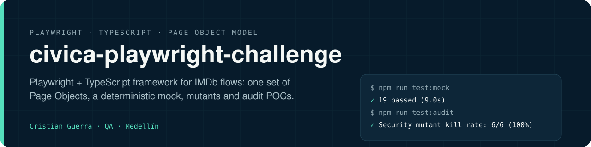
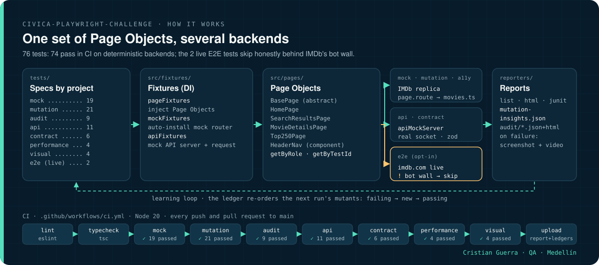
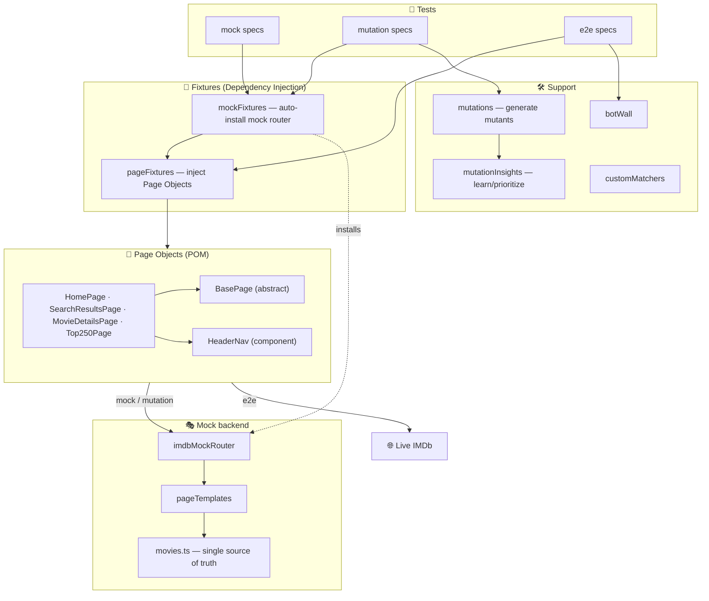
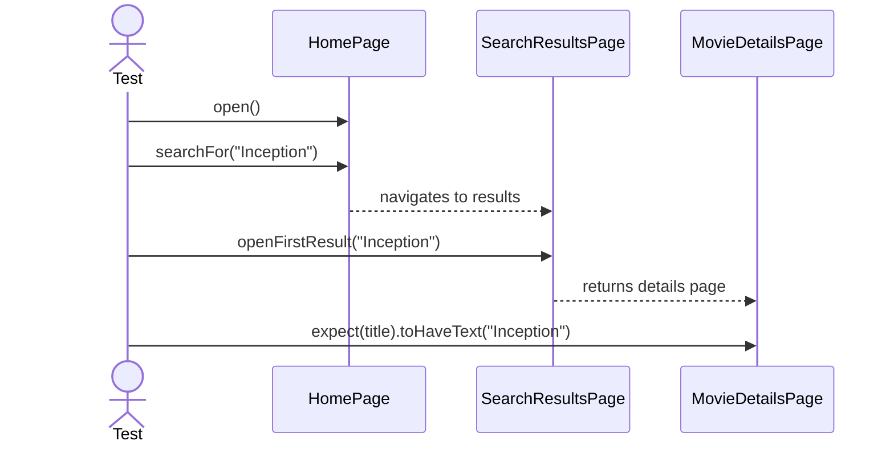
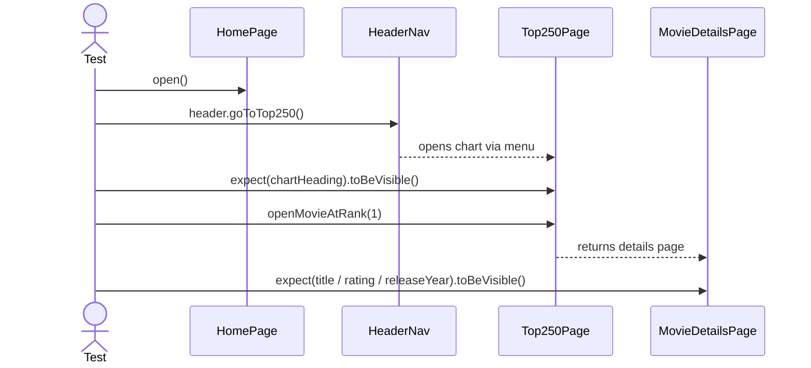
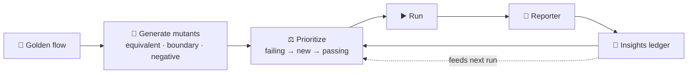

[Leer en español](README.es.md)

<p align="center">
  
</p>

## Explained like you're 8

Imagine you want to practice penalty kicks, but the real stadium has a guard who does not let robots in. So you build a copy of the stadium in your backyard, with the same goal and the same lines, and practice there. This project does that with IMDb, a big movie website: the real site asks robots "are you human?", so the tests run on a practice copy and use the very same instructions on both. It also asks the same question in silly ways, to be sure the tests are not passing by luck.

### A real example

- **Imagine that:** the robot searches for "zzqxw404movie", a name no movie has.
- **What should happen:** the site shows no results.
- **What the project does:** it makes this "mutant" out of "Inception" and checks that the copy finds nothing; the same family also tries "INCEPTION" and "Incep", which must still find the movie.
- **What we gain:** if search started matching anything, or stopped ignoring capital letters, a mutant would catch it. On CI the 21 mutant checks passed.

<p align="center">
  
</p>

The same animation as [MP4](docs/assets/explained.mp4).

### Hard words

| Word | What it means |
|---|---|
| Mock | A practice copy of a real website |
| Page Object | A cheat sheet for one page: where each button is, so the tests don't have to remember |
| Mutant | The same test with a small twist, to see if the checks really notice |
| Bot wall | The "are you human?" page that blocks robots |
| Skip | The test steps aside and says why, instead of failing for no reason |
| CI | A robot that runs all the tests every time someone uploads a change |

<div align="center">

# 🎬 Cívica — IMDb Test Automation Challenge

**A production-shaped test automation framework built with [Playwright](https://playwright.dev/) + [TypeScript](https://www.typescriptlang.org/), organized around the Page Object Model — with a deterministic mock layer, accessibility checks, and a self-learning mutant-scenario engine.**

[](https://github.com/criguex/civica-playwright-challenge/actions/workflows/ci.yml)
[](https://playwright.dev/)
[](https://www.typescriptlang.org/)
[](https://nodejs.org/)
[](LICENSE)

</div>

---

## 📑 Table of contents

- [Overview](#-overview)
- [How it works](#-how-it-works)
- [Test types](#-test-types)
- [Requirements traceability](#-requirements-traceability)
- [Highlights](#-highlights)
- [Architecture](#-architecture)
- [Project structure](#-project-structure)
- [Design principles](#-design-principles)
- [Locator strategy — no XPath/CSS](#-locator-strategy--no-xpathcss)
- [Test scenarios](#-test-scenarios)
- [Mutant scenarios — coverage that learns](#-mutant-scenarios--coverage-that-learns)
- [Accessibility](#-accessibility)
- [Audit POCs — a future security-audit service](#-audit-pocs--a-future-security-audit-service)
- [Why a mock layer?](#-why-a-mock-layer)
- [Getting started](#-getting-started)
- [Available scripts](#-available-scripts)
- [Configuration](#-configuration)
- [Reports & artifacts](#-reports--artifacts)
- [Continuous integration](#-continuous-integration)
- [Grow & migrate](#-grow--migrate)
- [Tech stack](#-tech-stack)
- [Author](#-author)

---

## 🎯 Overview

This repository implements the technical challenge: **build a test-automation
framework with Playwright + TypeScript, apply the Page Object Model, avoid
XPath/CSS locators, and automate two common IMDb user flows** — then takes it
further with data-driven coverage, accessibility checks and a learning mutation
engine.

IMDb actively blocks automation behind a _"Let's confirm you are human"_ wall
(see [Why a mock layer?](#-why-a-mock-layer)). Because a good framework must stay
**green and demonstrable regardless of a third party's availability**, the suite
runs in projects that share the **exact same Page Objects**:

| Project           | Backend                                          | Reliability                                         | When                                        |
| ----------------- | ------------------------------------------------ | --------------------------------------------------- | ------------------------------------------- |
| **`mock`**        | In-process IMDb replica (request interception)   | ✅ Deterministic, offline, always green             | Default · CI · demos                        |
| **`mutation`**    | Mock + generated mutant scenarios                | ✅ Deterministic, self-learning                     | Coverage expansion                          |
| **`audit`**       | Security-audit-service POCs (web/mobile/mutants) | ✅ Deterministic, offline                           | Service preview — [docs](docs/AUDIT-POC.md) |
| **`api`**         | In-process mock backend (real socket)            | ✅ Deterministic, offline                           | API + contract tests                        |
| **`performance`** | Mock + Navigation Timing API                     | ✅ Deterministic, generous budgets                  | Regression guard                            |
| **`visual`**      | Mock + Linux-baseline screenshots                | ✅ Deterministic on Linux (CI) — opt-in elsewhere   | Pixel-regression guard                      |
| **`e2e`**         | Live `imdb.com`                                  | ⚠️ Best-effort — skips honestly behind the bot wall | Opt-in exploration                          |

> **76 tests — 74 passing, 2 honestly skipped** (live E2E behind the anti-bot wall). See [Test types](#-test-types) for the full catalog.

---

## 🔭 How it works

<p align="center">
  
</p>

Specs are grouped into Playwright projects. Fixtures inject the Page Objects and, for the mock-backed suites, auto-install the IMDb mock router before each test. The same Page Objects then talk to the offline IMDb replica, the in-process API server, or the live site, where the E2E tests skip with a documented reason when the bot wall shows up. Reporters write the HTML and JUnit reports plus the mutation ledger that re-orders the next run's mutants.

<p align="center">
  
</p>

The animation replays the real log of CI run [38665514760](https://github.com/criguex/civica-playwright-challenge/actions/runs/38665514760) on `main` (2026-10-15): mock 19, mutation 21, audit 9, API 11, contract 6, performance 4 and visual 4, all passed (also as [MP4](docs/assets/how-it-works.mp4)). `docs/scenes/how-it-works.html` draws each frame from `?t=<seconds>` and `docs/scenes/export.sh` rebuilds the GIF and MP4 with headless Chrome and ffmpeg. The kids' animation works the same way with `docs/scenes/explained.html` (`?t=<seconds>&lang=en|es`) and `docs/scenes/export-explained.sh`.

---

## 🗂️ Test types

| Type                    | What it validates                                                          | Command                    | Runs in CI                                               |
| ----------------------- | -------------------------------------------------------------------------- | -------------------------- | -------------------------------------------------------- |
| **UI (mock, POM)**      | TC1/TC2 flows, data-driven catalogue, case-insensitivity, no-results path  | `npm run test:mock`        | ✅ Yes                                                   |
| **Accessibility**       | axe-core `serious`/`critical` WCAG 2 A/AA violations on every mock page    | `npm run test:a11y`        | ✅ Yes (part of `mock`)                                  |
| **Smoke**               | Fast `@smoke` subset — one happy path per required test case (TC1 + TC2)   | `npm run test:smoke`       | ➖ Not separate (covered by `mock`)                      |
| **Mutation (learning)** | Self-checking mutant scenarios, prioritized from a learning ledger         | `npm run test:mutation`    | ✅ Yes                                                   |
| **Audit POCs**          | Web PII/secret/header exposure, Android static analysis, auditor kill rate | `npm run test:audit`       | ✅ Yes — see [AUDIT-POC.md](docs/AUDIT-POC.md)           |
| **API**                 | Status codes, response shape, headers against a real mock backend          | `npm run test:api`         | ✅ Yes                                                   |
| **Contract**            | Response schemas (zod) — a drift is reported, the test is never adapted    | `npm run test:contract`    | ✅ Yes                                                   |
| **Performance budgets** | Navigation Timing (`domContentLoaded`/`load`) within generous thresholds   | `npm run test:performance` | ✅ Yes                                                   |
| **Visual regression**   | Pixel diff (`toHaveScreenshot`) vs. Linux baselines generated via Docker   | `npm run test:visual`      | ✅ Yes — Linux-only baselines, see note below            |
| **E2E (live)**          | Same Page Objects against real `imdb.com`; honest skip behind the bot wall | `npm run test:e2e`         | ⚠️ Opt-in (included in `npm run test:all`, always skips) |

**Visual regression determinism** — Playwright names screenshot baselines per
OS (`*-linux.png` / `*-darwin.png` / `*-win32.png`), and only the `*-linux.png`
files are committed, generated inside the repo's [`Dockerfile`](Dockerfile)
(same pinned Playwright/Chromium version CI installs). A baseline taken on
macOS/Windows is simply never picked up by CI. If this ever turns out flaky on
CI's Ubuntu runner, drop the "Run visual regression suite" step from
[`ci.yml`](.github/workflows/ci.yml) and keep `npm run test:visual` as a
local/opt-in check — see [docs/GROWTH.md](docs/GROWTH.md) and
[docs/MIGRATION.md](docs/MIGRATION.md) for the Docker baseline-generation recipe.

---

## ✅ Requirements traceability

| #   | Requirement                                        | Where it lives                                                                                                                                               |
| --- | -------------------------------------------------- | ------------------------------------------------------------------------------------------------------------------------------------------------------------ |
| 1   | Playwright + TypeScript                            | [`package.json`](package.json), [`tsconfig.json`](tsconfig.json)                                                                                             |
| 2   | Page Object Model                                  | [`src/pages/`](src/pages)                                                                                                                                    |
| 3   | Config: browser / reporter / base URL              | [`playwright.config.ts`](playwright.config.ts)                                                                                                               |
| 4   | No XPath/CSS — use `getByRole` / `getByTestId` / … | every Page Object (see [strategy](#-locator-strategy--no-xpathcss))                                                                                          |
| 5   | **TC1** — Search & validate movie                  | [`tests/mock/searchMovie.mock.spec.ts`](tests/mock/searchMovie.mock.spec.ts) · [`tests/e2e/searchMovie.e2e.spec.ts`](tests/e2e/searchMovie.e2e.spec.ts)      |
| 6   | **TC2** — Navigate Top 250 (via menu)              | [`tests/mock/top250.mock.spec.ts`](tests/mock/top250.mock.spec.ts) · [`tests/e2e/top250.e2e.spec.ts`](tests/e2e/top250.e2e.spec.ts)                          |
| 7   | Mocks when nothing is operational                  | [`mocks/`](mocks)                                                                                                                                            |
| 8   | Best practices / camelCase / SOLID / scalable      | [design principles](#-design-principles)                                                                                                                     |
| ➕  | Data-driven + negative tests, deep validations     | [`tests/mock/`](tests/mock)                                                                                                                                  |
| ➕  | Accessibility (axe-core)                           | [`tests/mock/accessibility.mock.spec.ts`](tests/mock/accessibility.mock.spec.ts)                                                                             |
| ➕  | Learning mutant scenarios                          | [`docs/MUTATION-TESTING.md`](docs/MUTATION-TESTING.md)                                                                                                       |
| ➕  | Security-audit-service POCs                        | [`docs/AUDIT-POC.md`](docs/AUDIT-POC.md)                                                                                                                     |
| ➕  | API tests                                          | [`tests/api/movies.api.spec.ts`](tests/api/movies.api.spec.ts)                                                                                               |
| ➕  | Contract tests (zod schemas)                       | [`tests/api/movies.contract.spec.ts`](tests/api/movies.contract.spec.ts) · [`src/contracts/movieApiSchemas.ts`](src/contracts/movieApiSchemas.ts)            |
| ➕  | Performance budgets                                | [`tests/performance/navigationTiming.performance.spec.ts`](tests/performance/navigationTiming.performance.spec.ts)                                           |
| ➕  | Visual regression (opt-in on non-Linux)            | [`tests/visual/pages.visual.spec.ts`](tests/visual/pages.visual.spec.ts)                                                                                     |
| ➕  | Smoke tagging                                      | `@smoke` — [`tests/mock/searchMovie.mock.spec.ts`](tests/mock/searchMovie.mock.spec.ts) · [`tests/mock/top250.mock.spec.ts`](tests/mock/top250.mock.spec.ts) |

---

## ✨ Highlights

- **One Page Object suite, three backends** — the same abstractions drive the mock, the mutation engine and the live site.
- **Semantic locators only** — `getByRole`, `getByTestId`, `getByPlaceholder`. Zero XPath, zero CSS.
- **Dependency-injected Page Objects** via Playwright fixtures — specs read like plain English.
- **Deterministic mock server** — a router renders IMDb-shaped HTML from a single data source; tests never flake and run offline.
- **🧬 Learning mutant scenarios** — golden flows are mutated into many self-checking scenarios, prioritized from previous-run insights.
- **♿ Accessibility checks** — axe-core gates serious/critical violations on every mock page.
- **Custom matchers** — `toBeValidRating`, `toBeValidReleaseYear` for expressive, domain-level assertions.
- **Honest E2E** — live tests `skip` with a clear reason behind the bot wall instead of failing.
- **🔒 Audit-service POCs** — web-exposure scanner, Android static analysis, and mutants that measure the auditor's own kill rate.
- **API + contract tests** — Playwright `request` against a real in-process mock backend, schemas validated with zod via a `toMatchSchema` custom matcher.
- **📈 Performance budgets** — Navigation Timing checks on every mock page, with deliberately generous thresholds.
- **🖼️ Visual regression** — `toHaveScreenshot` baselines generated on Linux via Docker, opt-in elsewhere.
- **🏷️ Smoke tagging** — `@smoke` marks one happy path per required test case for a fast pre-push check.
- **CI-ready** — GitHub Actions runs lint + typecheck + every deterministic suite (mock, mutation, audit, API, contract, performance, visual) and uploads reports.

---

## 🏗️ Architecture



---

## 📁 Project structure

```text
civica-playwright-challenge/
├── src/
│   ├── config/testConfig.ts        # Typed, multi-environment config (TEST_ENV)
│   ├── fixtures/
│   │   ├── pageFixtures.ts          # Page Objects as injectable fixtures (DI)
│   │   ├── mockFixtures.ts          # Adds the auto-installed mock router
│   │   └── apiFixtures.ts           # Worker-scoped mock API server + request context
│   ├── contracts/movieApiSchemas.ts # 📐 zod schemas for the API/contract tests
│   ├── pages/
│   │   ├── basePage.ts              # Abstract parent: shared navigation
│   │   ├── homePage.ts              # Home + global search
│   │   ├── searchResultsPage.ts     # Find/results page
│   │   ├── movieDetailsPage.ts      # Title, rating, year, genres, runtime
│   │   ├── top250Page.ts            # Top 250 chart + ranking integrity
│   │   └── components/headerNav.ts  # Reusable menu component (composition)
│   ├── support/
│   │   ├── customMatchers.ts        # toBeValidRating / toBeValidReleaseYear
│   │   ├── botWall.ts               # Honest anti-bot detection for e2e
│   │   ├── mutations.ts             # 🧬 Mutant-scenario generator
│   │   ├── mutationInsights.ts      # Learning loop (load + prioritize)
│   │   └── mutationPaths.ts         # Ledger location
│   ├── audit/                       # 🔒 Audit-service POCs — see docs/AUDIT-POC.md
│   │   ├── webExposureScanner.ts · exposureDetectors.ts · secretPatterns.ts
│   │   ├── securityHeaders.ts · cookieAudit.ts
│   │   ├── androidStaticAnalyzer.ts
│   │   ├── securityMutations.ts · auditMutationPaths.ts
│   │   └── types.ts · auditReportRenderer.ts · auditReportWriter.ts
│   └── utils/logger.ts              # Single logging seam
├── tests/
│   ├── mock/                        # Deterministic suite (default) + a11y
│   │   ├── searchMovie.mock.spec.ts
│   │   ├── top250.mock.spec.ts
│   │   ├── movieDetails.mock.spec.ts
│   │   └── accessibility.mock.spec.ts
│   ├── mutation/                    # 🧬 Learning mutant scenarios
│   │   └── searchMutants.mutation.spec.ts
│   ├── audit/                       # 🔒 Audit POCs (web / mobile / mutants)
│   │   ├── webExposure.audit.spec.ts
│   │   ├── androidStaticAudit.audit.spec.ts
│   │   └── securityMutants.audit.spec.ts
│   ├── api/                         # API + contract tests (no browser)
│   │   ├── movies.api.spec.ts
│   │   └── movies.contract.spec.ts
│   ├── performance/                 # 📈 Navigation Timing budgets
│   │   └── navigationTiming.performance.spec.ts
│   ├── visual/                      # 🖼️ toHaveScreenshot baselines (opt-in on non-Linux)
│   │   └── pages.visual.spec.ts
│   └── e2e/                         # Live-site suite (opt-in)
│       ├── searchMovie.e2e.spec.ts
│       └── top250.e2e.spec.ts
├── mocks/
│   ├── data/movies.ts · accountApp.ts · androidApp.ts · movieApi.ts   # Catalogues — single source of truth
│   └── server/
│       ├── imdbMockRouter.ts        # Request interception → HTML
│       ├── accountAppMock.ts        # 🔒 Fictitious app for the web-exposure POC
│       ├── apiMockServer.ts         # Real HTTP server backing the API/contract tests
│       └── pageTemplates.ts         # IMDb-shaped HTML rendered from data
├── reporters/
│   ├── mutationInsightsReporter.ts         # Writes the search-mutant ledger
│   └── auditMutationInsightsReporter.ts    # 🔒 Writes the security-mutant ledger
├── docs/                            # Guides, ADRs, diagrams, screenshots
│   ├── GROWTH.md · MIGRATION.md · MUTATION-TESTING.md · AUDIT-POC.md
│   └── adr/0001…0006-*.md
├── .github/workflows/ci.yml         # CI pipeline
├── Dockerfile                       # CI-parity execution
├── eslint.config.js · playwright.config.ts · tsconfig.json
└── package.json
```

---

## 🧱 Design principles

### Page Object Model

Every page is a class hiding _how_ to interact with the UI behind
intention-revealing methods (`searchFor`, `openFirstResult`, `openMovieAtRank`).

### SOLID, applied pragmatically

| Principle                 | How it shows up here                                                                                                                                               |
| ------------------------- | ------------------------------------------------------------------------------------------------------------------------------------------------------------------ |
| **S**ingle responsibility | `testConfig` owns env; `logger` owns logging; each page owns one screen; the router owns interception; `mutations` owns generation; the reporter owns persistence. |
| **O**pen/closed           | `BasePage` centralizes shared behaviour; pages _extend_ it. New mutators/pages plug in without editing existing code.                                              |
| **L**iskov substitution   | Every Page Object is a drop-in `BasePage`; fixtures treat them uniformly.                                                                                          |
| **I**nterface segregation | `MovieDetailsPage` exposes only the facts under test; callers depend on nothing more.                                                                              |
| **D**ependency inversion  | Tests depend on injected fixtures, not on construction. Mock vs. live is swapped without touching an assertion.                                                    |

### Other conventions

- **camelCase** files/variables/methods; **PascalCase** classes/types.
- **Strict TypeScript** + **ESLint** (0-warning policy) + **Prettier**.
- **DRY data** — expected values are imported from the same module the mock renders from.
- **Composition over inheritance** — the menu is a component pages compose.
- Notable decisions captured as [ADRs](docs/adr).

---

## 🎯 Locator strategy — no XPath/CSS

| Element               | Locator                                                   | Why                              |
| --------------------- | --------------------------------------------------------- | -------------------------------- |
| Search box            | `getByPlaceholder('Search IMDb')`                         | User-facing text                 |
| Menu button           | `getByRole('button', { name: /open navigation menu/i })`  | Accessible role + name           |
| "Top 250 Movies" link | `getByRole('link', { name: /top 250 movies/i })`          | Accessible role + name           |
| Movie title           | `getByTestId('hero__pageTitle')`                          | Stable IMDb test id              |
| Rating                | `getByTestId('hero-rating-bar__aggregate-rating__score')` | Stable IMDb test id              |
| Release year          | `getByRole('link', { name: /^(19\|20)\d{2}$/ })`          | Accessible role + semantic shape |
| Ranked chart movie    | `getByRole('link', { name: /^\d+\.\s/ })`                 | Ranked, accessible name          |

> Resilient (survive DOM/styling refactors) and meaningful (failures point at a
> user-visible thing) — exactly why Playwright recommends them over XPath/CSS.

---

## 🧪 Test scenarios

### TC1 · Search and validate movie



Extended with **data-driven** coverage across the whole catalogue, a
**case-insensitive** variant, a **negative** "no results" path, and **deep
validations** (rating in range, plausible year, genres, runtime, canonical URL).

### TC2 · Navigate Top 250 movies (via menu)



Plus a **ranking-integrity** test: the chart is populated and correctly ordered.

---

## 🧬 Mutant scenarios — coverage that learns

The framework's forward-looking layer: instead of hand-writing every edge case,
**golden flows are mutated** into many self-checking scenarios, and **previous
runs teach the next one** which mutants matter most.



| Class        | Intent                      | Example (`Inception`)        | Expected    |
| ------------ | --------------------------- | ---------------------------- | ----------- |
| `equivalent` | Must not change behaviour   | `INCEPTION`, `  Inception  ` | still found |
| `boundary`   | Edge that should still work | `Incep` (partial)            | still found |
| `negative`   | Behaviour must change       | `zzqxw404movie`              | no results  |

```bash
npm run test:mutation
cat test-results/mutation-insights.json   # what it learned
```

📖 Full rationale, learning loop and roadmap: **[docs/MUTATION-TESTING.md](docs/MUTATION-TESTING.md)**.

---

## ♿ Accessibility

Every mock page is scanned with **axe-core** ([`accessibility.mock.spec.ts`](tests/mock/accessibility.mock.spec.ts)),
gating on `serious`/`critical` WCAG 2 A/AA violations — a pragmatic, non-flaky
bar. Because the mock is deterministic, a11y checks are stable and offline.

```bash
npm run test:a11y
```

---

## 🔒 Audit POCs — a future security-audit service

A preview of a service built on the same mock-first approach: scan what a
flow exposes over the wire, scan what an Android package declares, and
measure the auditor's own kill rate with security mutants — all offline, all
on fixtures.

```bash
npm run test:audit
```

- **Web exposure** — PII/secret leaks (emails, phones, Luhn-checked card
  numbers, JWTs/API keys), missing CSP/HSTS/X-Content-Type-Options, cookies
  missing Secure/HttpOnly/SameSite.
- **Mobile static audit** — dangerous permissions, exported components,
  cleartext traffic, debuggable builds, hardcoded secrets, from a decoded
  manifest fixture (documented path to a real APK via `rea`).
- **Security mutants** — plant one defect at a time over a hardened baseline
  and verify the scanners catch it; current kill rate **6/6 (100%)**.

📖 What each POC demonstrates, how to run it, and its honest limits:
**[docs/AUDIT-POC.md](docs/AUDIT-POC.md)**.

---

## 🎭 Why a mock layer?

Running the `e2e` suite against the real site returns IMDb's anti-bot
interstitial instead of the app:

<div align="center">
  
  <p><em>Live IMDb greets automation with a human-verification wall — outside our control.</em></p>
</div>

So the `mock` project intercepts every request (`page.route`) and answers with
**IMDb-shaped HTML rendered from a single data source** — same roles, same
`data-testid`s the Page Objects query. The result is a fast, offline,
100%-deterministic replica that the very same tests drive:

<div align="center">
  
  
  
  <p><em>The in-process mock: movie details · Top 250 chart · search results.</em></p>
</div>

And when the live site _is_ reachable, E2E runs the identical flow; when it is
not, it **skips honestly** with a documented reason — never a false red.

---

## 🚀 Getting started

### Prerequisites

- **Node.js ≥ 18** · npm

### Install & run

```bash
git clone https://github.com/criguex/civica-playwright-challenge.git
cd civica-playwright-challenge
npm install          # also installs Chromium (postinstall)

npm test             # deterministic mock suite (always green)
npm run test:mutation# learning mutant scenarios
npm run test:api     # API + contract tests against the mock backend
npm run test:e2e     # live IMDb (opt-in; skips behind the bot wall)
```

Expected default output:

```text
Running 19 tests using N workers
  ✓  TC1 · Search and validate movie …
  ✓  TC2 · Navigate Top 250 movies …
  ✓  Movie details · deep validations …
  ✓  Accessibility …
  19 passed
```

---

## 🧰 Available scripts

| Script                                           | Description                            |
| ------------------------------------------------ | -------------------------------------- |
| `npm test`                                       | **mock** suite (default, always green) |
| `npm run test:mock`                              | Same, explicit                         |
| `npm run test:mutation`                          | 🧬 Learning mutant scenarios           |
| `npm run test:a11y`                              | Accessibility checks only (`@a11y`)    |
| `npm run test:audit`                             | 🔒 Security-audit-service POCs         |
| `npm run test:api`                               | API tests against the mock backend     |
| `npm run test:contract`                          | 📐 Contract (schema) tests             |
| `npm run test:performance`                       | 📈 Performance budgets                 |
| `npm run test:visual`                            | 🖼️ Visual regression (Linux baselines) |
| `npm run test:visual:update`                     | Regenerate visual baselines            |
| `npm run test:smoke`                             | 🏷️ Fast `@smoke` subset                |
| `npm run test:e2e`                               | Live IMDb suite (opt-in)               |
| `npm run test:all`                               | All projects                           |
| `npm run test:headed` / `test:ui` / `test:debug` | Visible / interactive / step-through   |
| `npm run report`                                 | Open the last HTML report              |
| `npm run lint` / `lint:fix`                      | ESLint                                 |
| `npm run typecheck`                              | `tsc --noEmit`                         |
| `npm run format` / `format:check`                | Prettier                               |
| `npm run codegen`                                | Playwright codegen against IMDb        |

---

## ⚙️ Configuration

All in [`playwright.config.ts`](playwright.config.ts) + [`src/config/testConfig.ts`](src/config/testConfig.ts):

- **Browser** — Chromium (`Desktop Chrome`) per project; extend to Firefox/WebKit trivially.
- **Reporters** — `list` + `html` + `junit` + the mutation-insights ledger.
- **Environments** — `TEST_ENV=prod|staging|dev` selects a base URL; `BASE_URL` overrides. The mock router intercepts the chosen origin.
- **Diagnostics** — trace on first retry, screenshot + video on failure.
- **Locale** — forced `en-US` for deterministic copy/test-ids.

---

## 📊 Reports & artifacts

- **HTML report** → `playwright-report/` (`npm run report`).
- **JUnit XML** → `test-results/junit.xml` (CI dashboards).
- **Mutation ledger** → `test-results/mutation-insights.json` (learning input).
- **Audit reports** → `test-results/audit/*.json`+`.html` and `test-results/audit-mutation-insights.json` (see [AUDIT-POC.md](docs/AUDIT-POC.md)).
- **Visual baselines** → `tests/visual/*-snapshots/*-linux.png` (committed); diffs land in `test-results/` on a mismatch.
- **On failure** → screenshot, video and trace attached automatically.

---

## 🤖 Continuous integration

[`.github/workflows/ci.yml`](.github/workflows/ci.yml) runs on every push/PR to `main`:


CI runs every deterministic project, so the pipeline is fast and never fails
on IMDb's bot defenses. `e2e` is opt-in and not part of this job (see
[Test types](#-test-types)).

---

## 📈 Grow & migrate

- **[docs/GROWTH.md](docs/GROWTH.md)** — add pages, browsers, environments, Allure, sharding, husky; API/contract/visual-regression are already implemented, see [Test types](#-test-types).
- **[docs/MIGRATION.md](docs/MIGRATION.md)** — retarget to another site/app, run in Docker, cloud grids (BrowserStack/Sauce), other CIs (GitLab/Azure/Jenkins), upgrade Playwright.
- **[docs/MUTATION-TESTING.md](docs/MUTATION-TESTING.md)** — extend the learning coverage engine.
- **[docs/AUDIT-POC.md](docs/AUDIT-POC.md)** — the security-audit-service POCs, and how to scale them to a real app.
- **[docs/adr/](docs/adr)** — the decisions behind the design.

---

## 🛠️ Tech stack

| Tool                                                             | Role                                            |
| ---------------------------------------------------------------- | ----------------------------------------------- |
| [Playwright Test](https://playwright.dev/)                       | Runner, browser automation, fixtures, reporters |
| [TypeScript](https://www.typescriptlang.org/)                    | Strict typing                                   |
| [axe-core](https://github.com/dequelabs/axe-core)                | Accessibility engine                            |
| [zod](https://zod.dev/)                                          | Contract-test schema validation                 |
| [ESLint](https://eslint.org/) + [Prettier](https://prettier.io/) | Linting + formatting                            |
| [GitHub Actions](https://github.com/features/actions)            | CI                                              |
| [Docker](https://www.docker.com/)                                | Linux-parity execution + visual baselines       |

---

## 👤 Author

**Cristian Guerra** — QA Automation Engineer · [GitHub @criguex](https://github.com/criguex)

Built as a technical challenge submission. Licensed under [MIT](LICENSE).
