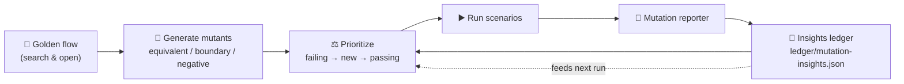

# 🧬 Mutant scenarios — coverage that learns

> The "future" layer of this framework: instead of hand-writing every edge case,
> we **mutate golden flows** into many scenarios and let **previous runs teach
> the next one** which mutants matter most.

This is the automation-testing analogue of the _flow-mutation_ strategy: take a
known-good ("golden") user journey and systematically perturb it to discover
where the application's behaviour changes when it shouldn't (or fails to change
when it should).

---

## Why

A single happy-path test proves the flow works **once, one way**. Real users
type `INCEPTION`, `inception`, partial titles, and gibberish. Writing each of
those by hand is tedious and always incomplete. A mutation engine:

- **widens coverage automatically** — one golden flow → N self-checking scenarios;
- **stays honest** — each mutant declares its expected outcome class, so it is a
  real assertion, not just a smoke run;
- **learns the order** — outcomes feed a ledger that decides which mutants run first next time.

---

## The three mutant classes

| Class        | Intent                               | Example (seed `Inception`)                | Expected    |
| ------------ | ------------------------------------ | ----------------------------------------- | ----------- |
| `equivalent` | Behaviour must **not** change        | `INCEPTION`, `inception`, `  Inception  ` | still found |
| `boundary`   | Probe an edge that should still work | `Incep` (partial prefix)                  | still found |
| `negative`   | Behaviour **must** change            | `Inception qzx404`, `zzqxw404movie`       | no results  |

Mutators live in [`src/support/mutations.ts`](../src/support/mutations.ts) and are
generated per seed title by `generateSearchMutants(title)`. Adding a mutator
instantly multiplies coverage across every seed.

---

## The learning loop



1. **Generate** — `generateSearchMutants()` expands each seed into the full set.
2. **Prioritize** — `prioritize()` reads the ledger and re-orders so that
   mutants that _failed in their last 5 recorded runs_ go first, then _never-seen_
   ones (new coverage), then the rest. Sorting is stable → the run stays
   deterministic. Order is the only thing it changes: never a verdict.
3. **Run** — scenarios execute against the deterministic mock.
4. **Record** — the [`mutationInsightsReporter`](../reporters/mutationInsightsReporter.ts)
   writes each `@mutant` outcome back to the ledger: `runs` (every run ever),
   `history` (last 5 statuses), `failures` and `timeouts` (counted inside those 5).
5. **Repeat** — the next run learns from this one.

The ledger lives in `ledger/` (git-ignored), **not** in `test-results/`:
Playwright empties its output folder at the start of every run, which used to
wipe the ledger so `runs` never got past 1. A ledger left at the old
`test-results/` path is read once and carried over. On a fresh clone it is
empty and mutants run in declared order. In CI, the workflow downloads the
`mutation-insights` artifact of the latest completed `main` run before the
mutants and uploads the updated one at the end; with no previous artifact it
starts fresh.

**Forgetting.** `failures` counts only `failed` results among the mutant's last
5 runs (`HISTORY_WINDOW` in `src/support/mutationInsights.ts`), so one old
failure stops pushing a mutant to the front after 5 more runs. A sliding window
was picked over decay weights because it is easy to read straight from the
JSON.

**Timeouts.** A `timedOut` result goes to `timeouts`, not `failures`, and does
not move a mutant up: it usually says more about the machine than about the
mutant. `interrupted` counts as neither.

**Corrupt ledger.** Loading is fail-open but not silent: the run prints a `⚠`
warning, adds a `ledger-warning` annotation to each mutant in the HTML report,
runs in declared order, and keeps the unreadable file as
`ledger/mutation-insights.json.corrupt` before writing a fresh ledger. The
unit tests in `tests/unit/mutationInsights.unit.spec.ts` cover ordering,
forgetting, timeouts and the corrupt file.

---

## Run it

```bash
npm run test:mutation        # generate → prioritize → run → record
cat ledger/mutation-insights.json   # inspect what it learned
```

---

## Roadmap

This engine is deliberately small but designed to grow:

- **More golden flows** — mutate the Top 250 journey (rank boundaries, deep
  pagination), not just search.
- **Richer mutators** — accents/diacritics, emoji, RTL text, very long inputs,
  injection-style payloads (as negative/robustness mutants).
- **Smarter learning** — weight by _flakiness rate_ (the 5-run window already
  covers recency), auto-quarantine chronically-flaky mutants, and surface a
  "most valuable mutants" report.
- **Failure-driven generation** — when a mutant catches a real bug, auto-derive
  neighbouring mutants around it (the failure becomes a new seed).
- **Metamorphic relations** — assert invariants across mutants. With the mock's
  case-insensitive substring search, results for a prefix of `X` ⊇ results for
  `X` (searching `The` returns 4 titles, `The Dark Knight` returns 1), not the
  other way round.

See also: [GROWTH.md](GROWTH.md) · [ADR-0005](adr/0005-mutant-scenarios.md).
